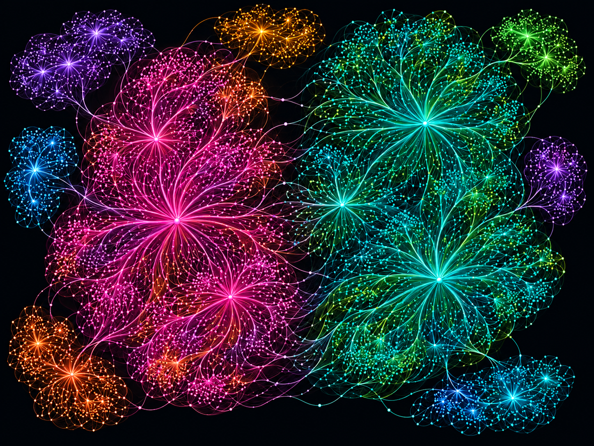
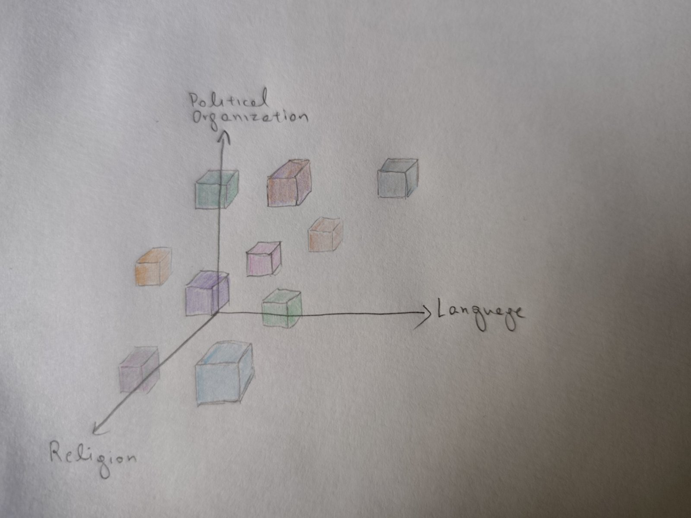
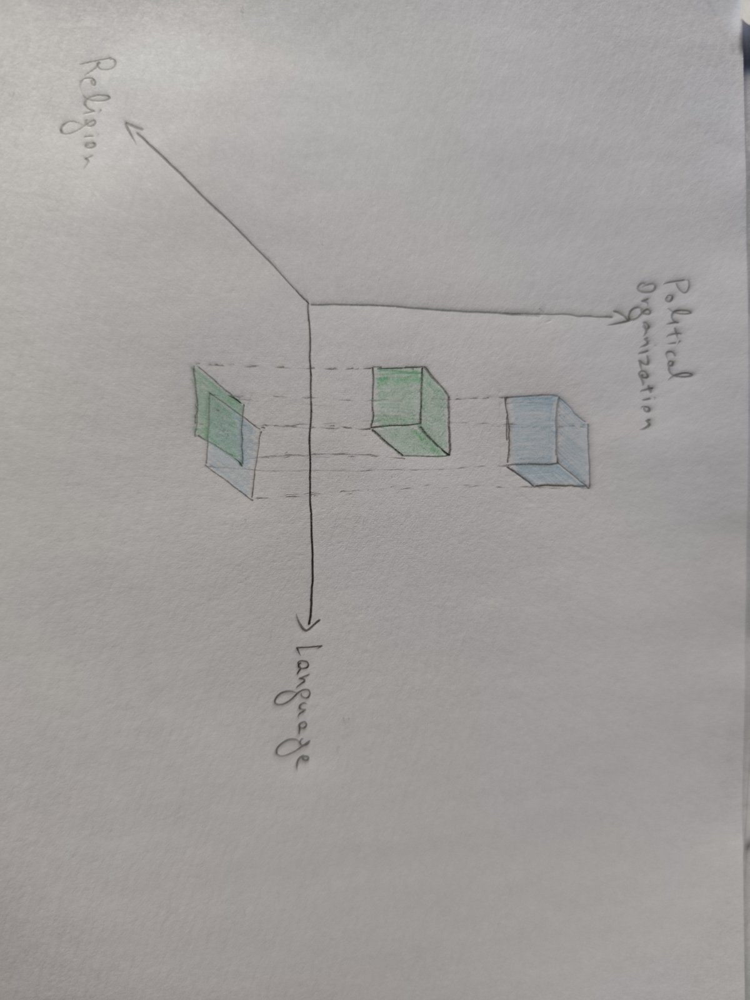

# Nations as micro humanities
The concept of humanity represents the ultimate human collective, the broader human civilization of which all people 
feel themselves to be a part. Yet, from its very beginnings, human civilization has been remarkably diverse, 
composed of distinct local cultures, much like a galaxy is composed of individual 
star systems that interact with each other to form a greater whole. It is precisely these distinct cultural entities 
that I define as nations. In my view a nation is fundamentally, a distinct cultural entity.

As humanity spread geographically, the vast distances separating different groups made interaction between them 
impossible, and the first distinct cultural entities, or the world's earliest nations, began to take shape.
Over time, through the changes that time inevitably brings, these cultural entities transform, disappear, 
merge, split apart, assimilate into one another, and evolve into new forms.

These cultural bubbles, create among their members a sense of a shared, familiar environment, 
satisfying the innate human need to belong. Gradually, they give rise to a common identity that, through its 
influence on the human psyche, shapes individual behavior, value systems, aspirations and decisions, ultimately 
influencing the course of human history.

This characteristic of humanity, its evolution through autonomous, identity-bearing cultural entities, 
has both advocates and critics. In my view however, its benefits far outweigh its drawbacks, not only 
for aesthetic reasons but also for [ethical]()
and pragmatic ones. In the aesthetics dimension, imagine a world filled **exclusively** with Egyptian pyramids, or Greek temples, or 
Gothic cathedrals, or any other single form of cultural achievement, however magnificent. How monotonous would such a world be? 
Diversity can be by itself a source of beauty.

On the pragmatic realm, cultural diversity strengthens humanity's resilience helping to safeguard its long-term well-being. 
If, for example, one culture declines due to the dominance of flawed ideas or any other internal or external cause, 
another contemporary culture may be flourishing and prosperous, thereby preventing humanity as a whole from descending 
into darkness. Moreover, however strongly one may believe that their own culture and way of life are uniquely right 
or destined to determine humanity's fate, the truth is that no one knows whether any grand objective purpose exists, 
let alone what that purpose might be. How, then, could anyone objectively determine who is moving in the right 
direction and who is not? More on this argument [here](#good-evil-and-self-acceptance).
In any case, regardless of our judgments, this diversity of identities is a fact, and understanding it is therefore, at the very least, useful.

The influence radius of these cultural bubbles was, and continues to be, constrained by the limits of human interaction which 
are determined primarily by the ability to communicate. More precisely, the crucial factor that determines the 
integration of an individual into a particular cultural environment, is the diversity (or lack thereof) 
of the cultural entities that influences them.
In other words, what matters is the mix of cultural origins represented among the sources of sensory input 
an individual receives, especially during their formative years. This sensory input encompasses 
any information an individual perceives through their senses, like music, literature,
art, education, cuisine, architecture, exposure to myths, traditions and the local natural environment, 
religious practices, customs, news, everyday discussions and everything 
else that is part of a cultural environment. The sources that generate this input, include educational and religious institutions, 
the media, prominent contemporary or historical figures, professional and social circles, ordinary people and anything else
that produces information within an environment. 
An individual's sense of identity emerges through an internal process shaped by the interaction between this cultural 
input and their own temperament.

> This web of interactions can be represented as an interconnected network of information flow, where each node 
represents an individual or a source of cultural influence. 

Individual cultures are characterized by dense 
internal connections, with many nodes sharing common sources, while connections between different cultures 
are comparatively sparse. Broader cultural clusters, composed of distinct subcultures, can also emerge, 
with interactions among their constituent cultures being more numerous and frequent than those between separate clusters.

In the past, the diversity of these sources was naturally restricted by geography and technological limitations, 
so the extent to which distant cultures could influence
individuals was relatively restricted. Yet as technology advances, it greatly enriches the variety of sources from which individuals 
receive sensory input, allowing dominant cultures to extend their influence far beyond their traditional geographical boundaries. This, 
in turn, risks driving the world toward a gradual erosion of cultural diversity, ultimately leading to 
a potentially dangerous gray homogenization.

But what are the fundamental forces that determine the nature of the information that 
circulates within a cultural network, distinguishing one culture from another? 
I would argue that there are five primary characteristics that, based on their historical significance
and their insulating capacity, both define and protect a cultural entity. 
Each carrying a different weight depending on the historical era and the cultural entity in question:
1. Language 
2. Religion 
3. Historical memory 
4. Political organization
5. Ancestry

I intentionally distinguish historical memory from ancestry because the former is purely cultural, 
whereas the latter has an immutable biological foundation that can't be altered no matter the environment in which an individual lives.
Someone might argue however, that using a cultural framework to define nations would make the ancestry component largely irrelevant.
Yet, I believe it still has a role as a formative and protective force, at least for some people, influencing the attachment to one's origin
through the deeply rooted human desire to respect and honor one's ancestors. This could lead individuals to consciously 
choose the culture of their ancestors over the one of their current environment, rejecting some influence in favor of 
another, affecting the nature of influence they themselves exert. 

Even a single difference in one of those fundamental attributes may be sufficient to establish some degree of cultural differentiation. 
Naturally, the greater the number and significance of these differences, the more culturally distinct the entities 
become. Thus, there are nations that are remarkably similar (consider Americans and Canadians) and others that differ 
substantially across nearly all dimensions (say, Somalis and Finns).

This indicates that a nation is not firmly defined by exactly five attributes. 
On one hand there are examples of stateless nations, like the Jewish one, 
whose identity was sustained for centuries largely through religion and historical memory, while on the other hand there are nations 
for which political organization (the existence of two different states) is their most important distinguishing factor. 
In the USA and Canada example, one could argue that they could be categorized as a single nation, since large segments 
of their population share three out of five fundamental attributes (language, religion and ancestry) 
with a large part of their historical memory being common too. However, the mere 
existence of two different states, gradually forms a distinct historical memory and in the long run, it can form a 
distinct cultural entity and consequently a new identity. Conversely, if the main differentiator was to disappear, 
the two entities might gradually converge into one single cultural entity.

Within this context we can represent nations as five-dimensional objects, with each dimension corresponding to one fundamental 
characteristic. Depending on the similarity of their identities, some of these objects may lie closer to one another, 
while others may be farther apart. The projections of these objects onto lower dimensions may also function as 
identities in their own right, and overlapping projections indicate similarity. **Every such object and projection 
constitutes a distinct identity which, as a cultural attractor, influences the course of human history**. 
Since it is cognitively easier to reason in three dimensions, I use simplified three-dimensional representations in the provided illustrations.

  

    
  

  

    
  

We can also use this framework to understand the process of national assimilation. Assimilation involves the gradual 
transformation of the characteristics that distinguish one population from another. As these characteristics change, 
often at different rates, new intermediate identities may emerge before the process reaches its eventual outcome. 
Since such transformations can unfold over many generations, historical snapshots allow us to observe populations 
at different stages of cultural assimilation.

One example comes from medieval Iberia, where Muslim rule lasted for several centuries. During this period, 
much of the native Iberian population underwent a gradual process of Arabization, adopting elements of the dominant 
Arabic language and culture. In the course of this transformation, various intermediate identities emerged, occupying 
positions somewhere between the original Iberian cultures and the increasingly Arabized society of al-Andalus. 
One such group was the Mozarabs, Christians living under Muslim rule who adopted the Arabic 
language and culture while retaining their Christian religion. Conversely, another group, the Muwallads, consisted 
largely of indigenous Iberians, converted to Islam while retaining their Iberian linguistic and cultural heritage.

Another example is that of the Karamanlides, the Turkish-speaking Orthodox Christian communities of 
Cappadocia in Asia Minor. They adopted Turkish as their native language while retaining their Orthodox 
Christian faith and religious traditions from the previous Byzantine era. Particularly interesting is the fact that 
they were writing Turkish using the Greek alphabet and as a result, we can find the Old and New Testament 
written in Turkish but with Greek letters. Following the population exchange agreement between Greece and Turkey 
in 1923, most of Karamanlides were relocated to Greece along with other Greek populations of Asia Minor. 

These cases are especially revealing because they demonstrate how a population can share the language of 
one cultural community while maintaining strong religious and historical ties to another, giving rise to 
intermediate yet distinct cultural identities along the way.

# Some observations
1. In this framework, historical memory has a very large scope. It contains customs and traditions.
It includes not only past events but also present events of great importance, 
such that they are already considered historical. For example, theater in classical Greece was already regarded 
by contemporaries as a defining element of their cultural identity so its existence was already of historical 
importance. The American flag on the Moon is another such case. I classify such significant cultural elements 
under historical memory.

1. Locality greatly enhances the historical memory and thus strengthens the sense of identity that is affected by it.

1. Political organization reflects the way a society is structured, how it makes decisions, distributes resources, educates the young, 
manages security and challenges, defines rights and obligations. The modern state is the most familiar form of 
political organization and plays its own great role in identity formation. There are cases where the populations of two 
neighboring states share four of the five primary characteristics but differ in political organization, and this 
alone may generate identity differentiation. Besides, over the course of time this differentiation in political organization 
can gradually create its own historical memory pushing even more towards a distinct identity. Examples include the 
United States and Canada, North and South Korea, Romania and Moldova and others. This also implies that if the difference 
in political organization ceases to exist, identities may converge into one.

1. The way of life (customs, traditions, myths, practices, music, architecture, cuisine and so on) or what we commonly 
refer to as shared culture, is a derivative of historical memory and religion as well as political organization and language. 

1. Any projection of a five-dimensional identity onto lower dimension spaces can function as a distinct cultural 
attractor. Multidimensional identities thus possess multiple expressions and shades.

1. The same characteristic may be of minor importance in one identity but far more significant in another. 
Ancestry for example, plays little to no role in the case of the United States. Its identity has been 
shaped to encompass multiple genetic profiles, effectively rendering it independent of them, leading to a more 
generic identity that spans the entire 5th dimension (or alternatively it can be thought of as a generic 4d identity 
instead of a narrower 5d one). By contrast, in the case of China, ancestry plays a much more substantial role.

1. Any combination of any number of the five basic characteristics, capable of generating emotional identification 
and differentiation from others, can function as a distinct identity and begin to influence the course of human 
history. For example the Jews were stateless for centuries, they were spread out in Europe, they spoke variations of the 
local languages and were members of the local political organizations, yet their main collective identity was 
defined by religion and historical memory. These two attributes alone maintained their sense of national identity.
In extreme cases, even a single characteristic might suffice to initiate a process of identity autonomy. 
However, such a nascent identity would be highly fragile and prone to merging with neighboring ones.

1. The closer two identities are, the more likely it is that they will merge into one, or that one will absorb the other. A case in point is the 
Normans, who were ultimately absorbed into the kingdoms of France and England, despite having a highly significant 
political organization that endured for roughly two centuries and influenced medieval Europe, to a point that it 
started generating its own historical memory. However, 4 of the 5 characteristics were very similar to those 
of neighboring kingdoms. Once their political organization collapsed, maintaining a distinct identity became 
impossible. Language and religion have been, and remain, the dominant attributes of differentiation.

1. Solidarity arises from shared self-perception. 

1. The use of a distinct name for an identity reinforces its differentiation from others.

1. The position of the volume occupied by an identity changes over time. Identities evolve.

1. These five primary characteristics have been decisive in identity formation from the deep past to the present, 
though their influence may vary over time and place.

There are many historical processes that could be examined through this lens, processes that unfold over centuries, 
for example the Hellenization of Anatolia and its subsequent Turkification, the temporary emergence of the 
Mozarab and Muladi identities in the Arabic Iberia, the Arabization of Egypt etc.  

> The purpose of this post is to briefly present a simple mechanistic framework through which we can understand 
> historical processes and project future developments in a structured way.

# Meta-identities
Distinct cultures produce distinct identities, and in this context, an identity is the self-perception of being an 
integral part of a particular culture, adhering to its fundamental cultural content. As cultures evolve,
so do the identities they produce and the essence of what it means to belong to a particular culture.

Yet a cultural identity can be classified as an evolution of its predecessor rather than an entirely new one, if some of the five 
fundamental characteristics connect it to its previous form. This connection forms a distinct cultural and identity branch. 
An individual who understands these fundamental characteristics and who is aware of this 
historical trajectory could identify with the entire branch rather than merely with its current form. 
This identity branch, when viewed as a whole, can give rise to the notion of an "identity of identities," 
or a meta-identity, one that spans the entire branch, encompassing all of its historical forms.

Most ancient cultural branches that have survived to the present day (Chinese, Greek, Indian, Iranian, etc.) 
have passed through different civilizational epochs, undergoing major transformations along the way. 
Each cultural phase gives rise to a distinct identity without, however, starting from a blank slate. Rather, 
it incorporates elements of its predecessor and evolves from them. This process never stops. 
Identities continue to evolve even within a single epoch, although the changes are generally less pronounced.

**The Greek case**  
The Greeks, in particular, have undergone several transformations over the centuries, the most profound being 
the transition from the "classical" form of their identity to the "Orthodox" one. I use these terms here in a 
broad cultural sense, rather than restricting them to their conventional historical and religious meanings 
respectively. These two forms are the main clusters of the Greek identity branch, 
corresponding broadly to the periods before and after the rise of Christianity. 
However, significant evolution also occurred within each of them.

For example, an important transformation within the first cluster was the transition from the Mycenaean to the 
Classical era. During this transition, the fundamental religious worldview remained largely unchanged, 
the Greek language survived and evolved, and with it, many elements of historical memory, including myths, 
legends, and heroic traditions. 
Yet the Bronze Age collapse of the 12th century BC and the subsequent Dark Ages brought profound transformations. 
Political organization changed dramatically. The palatial system collapsed, and the great administrative centers 
were largely abandoned. Parts of the historical memory were lost, most notably the writing system. 
Religion also evolved. Some deities disappeared, while others rose to prominence or assumed new roles. 
These transformations unfolded over several centuries until, at the other end of this process, 
a new cultural entity emerged as an evolution of its predecessor.

The subsequent seismic shift from Greco-Roman antiquity to the medieval Christian world produced the most 
profound transformation of Greek identity. The most groundbreaking change was the adoption of Christianity, 
accompanied by fundamental changes in political organization following the decline of the Western Roman Empire 
and the gradual crystallization of a new political entity, the Eastern Roman Empire. 
Over the course of several centuries, the Orthodox identity of "Romios" (Roman) took shape, 
describing the Orthodox, native Greek-speaking inhabitant of the empire. The term "Hellenes," 
used by the ancient Greeks to describe themselves, had become associated with paganism during the early 
Christian period and was deliberately avoided for that reason. Consequently, this new Orthodox 
identity distanced itself from its own "pagan" past.

Yet it shared many cultural elements with that past, preserved mainly through the Greek language and literature, 
which kept much of the historical memory of the preceding era alive. In many cases, students were still 
educated through Homer, as they had been in the Classical age, while scholars continued to copy, comment on, 
and imitate the classics. In a sense, just as the Mycenaean world shaped the Classical one, the Classical world 
shaped the Orthodox one, albeit to a lesser degree, due to the challenges that followed the rise of Christianity. 
Ultimately, one of the most fortunate consequences of this enduring continuity was its contribution 
to the European Renaissance, which was fueled by the Byzantine scholarship that preserved, copied, 
and ultimately transmitted classical works to the West, after the fall of Constantinople.

An interesting historical fact is that, because the name "Rome" carried immense political weight, 
both East and West claimed the Roman imperial legacy for themselves while denying it to the other. 
Westerners were referred to as Franks, Germans, or Latins by the Byzantines, 
while the Eastern Roman Empire was called the Empire of the Greeks by Westerners (`Imperium Graecorum`).
The following opening titulature from the diplomatic correspondence (c. 1177 AD) between the Byzantine emperor Manuel I Komnenos 
and Frederick Barbarossa of the Holy Roman Empire is quite entertaining, almost hilarious, 
in the way it illustrates how both sides claimed the imperial status of Rome for themselves 
while simultaneously downgrading each other through the labels "German" and "Greek" which, 
ironically, reveal much about the cultural character of their respective empires.

> Manuel I Komnenos: 
> "Manuel, faithful emperor in Christ God, purple-born, divinely crowned, ruler, mighty, exalted, ever Augustus 
> and governor of the Romans, Komnenos, to the most noble and glorious King of Germany and Emperor, 
> beloved brother of our Empire, greetings and brotherly affection."
> 
> Frederick Barbarossa:
> "Frederick, by the favour of divine mercy, illustrious conqueror, Emperor of the Romans, crowned by God, 
> exalted, faithful in Christ, great, peaceful, glorious, Caesar, governor of the Greeks and ever Augustus, 
> to the noble and illustrious King of the Greeks and Emperor, Manuel, his beloved brother, greetings 
> and brotherly affection."

Latin original:  
"Manuel in Christo Deo fidelis imperator, porphirogenitus, divinitus coronatus, regnator, potens, excelsus, 
semper augustus et Romanorum moderator ó Komninòs, nobilissimo et gloriosissimo regi Alamanniae et imperatori 
et dilecto fratri imperii nostri salutem et fraterni amoris affectum." 
"Fridericus divina favente clementia inclitus triumphator, Romanorum imperator, a Deo coronatus, sublimis, 
in Christo fidelis, magnus, pacificus, gloriosus, cesar, Grecorum moderator et semper augustus, nobili 
et illustri regi Grecorum et imperatori, Emanueli, dilecto fratri suo, salutem et fraternę dilectionis affectum."

Returning to our discussion of identities, this Orthodox identity underwent another significant transformation, 
namely a refocusing of its historical memory on its own ancient Greek heritage and a gradual distancing 
from its Roman heritage, eventually giving rise to the modern Greek identity.
This process had already begun from the 13th century, long before the Modern Greek Enlightenment of the 18th century, 
and was especially intensified following the Fourth Crusade, a period during which members of the 
Byzantine intelligentsia began to refer publicly to their ancient Greek roots. 
A prominent example is the emperor of Nicaea, John III Doukas Vatatzes, who, in his 
<a href="https://www.impantokratoros.gr/F20A9610.el.aspx" target="_blank" rel="noopener noreferrer">correspondence</a> 
with Pope Gregory IX (1237), emphasized the Greek heritage of his empire.

One could even argue that the Empire of Nicaea, which was established after the sack of Constantinople by the Latins
and later reconquered the city, was the first state to officially incubate the seeds of the modern Greek identity. 
This emerging identity was essentially an evolution of the Byzantine one, with the major difference being 
that its Roman historical heritage was increasingly being replaced by an emphasis on its ancient Greek roots. 
The distinction between this new identity and its predecessor therefore, lies primarily in the historical memory 
component, making it a clear example of identity evolution.

It is entertaining to imagine taking a random modern Greek and transporting him back to a Byzantine city of the 
11th century. He would probably feel surprisingly at home in his interactions with the locals, who, 
incidentally, might recognize him as a fellow "Romios." Inside a church, in particular, 
he might barely be able to tell whether he was in the 11th or the 21st century. 
The irony is that, following the Greek War of Independence (1821), the pendulum swung in the opposite direction. 
Despite the fact that modern Greek identity is very similar to its Byzantine predecessor, 
it has become disproportionately associated with its Classical form, especially in the eyes of foreigners. 
In any case, the concept of meta-identities allows us to encompass all these historical forms within a single 
overarching entity.

**A few words about the Turkish case**  
The notion of a meta-identity can also be observed in younger cultures. Turkish culture for example, exhibits a 
comparable pattern when viewed across a sufficiently long historical timescale. The sense of identity 
of a 7th-century AD nomadic Tengrist Göktürk of the Asian Steppe would have differed profoundly from that of a 
modern Muslim Turk in Asia Minor. Nevertheless, the Göktürks are rightly regarded as part of the 
broader Turkish cultural heritage, as reflected in the modern Turkish education system, cultivating a 
Turkish meta-identity that transcends the distinct historical identities that compose it.
