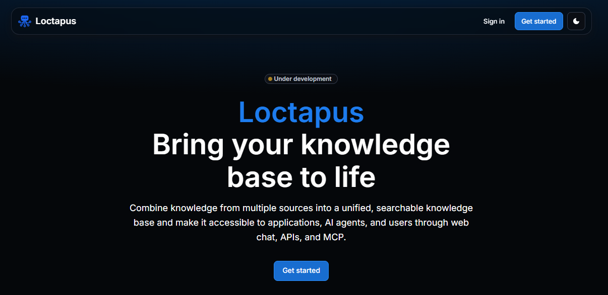

## Loctapus

[Loctapus](https://loctapus.com/) is the latest [open source](https://github.com/dimyG/Loctapus) project I'm working on. 
I started it with the dual purpose of learning about RAG and familiarizing myself with a fully agentic 
approach to software engineering. 

> It is a platform that brings together knowledge from multiple sources into a unified, searchable knowledge base and makes it accessible to applications, AI agents, and users through various interfaces, including web chat, APIs, and MCP.

The most typical use case for such a service, is making a company's internal knowledge base accessible
to employees and customers through a chat interface or to AI agents through an API or MCP. 
**The project is still under development, and is currently in demo mode.**  

## How the project is developed

- An initial MVP [specification](https://github.com/dimyG/Loctapus/blob/master/docs/2026-10-06-initial_rag_mvp_agent_project_context.md)
  was distilled from a long conversation with GPT-6 Sol. It describes, at a high level, what
  a first working version must do.
- A [roadmap](https://github.com/dimyG/Loctapus/blob/master/docs/superpowers/specs/2026-10-06-roadmap.md)
  breaks that specification into small vertical slices. Each slice spans the whole stack
  (database, API and front end), so it can be tested end to end as soon as it is done.
- All work is done by AI agents in [OpenCode](https://opencode.ai) with models from
  [OpenRouter](https://openrouter.ai), following the
  [obra/superpowers](https://github.com/obra/superpowers) methodology.

## Architecture

### Services

The system runs as 8 Docker Compose services:

| Service                  | Role                                                                 |
| ------------------------ | -------------------------------------------------------------------- |
| `db`                     | PostgreSQL with pgvector: all data, including chunk embeddings       |
| `rabbitmq`               | Message broker for background tasks                                  |
| `garage`                 | S3-compatible storage for the uploaded files                         |
| `one-off-initialization` | Applies database migrations before the API starts, then exits        |
| `api`                    | FastAPI application                                                  |
| `worker`                 | Celery worker that runs the background tasks                         |
| `dispatcher`             | Reads pending tasks from the outbox table and sends them to RabbitMQ |
| `web`                    | Caddy: serves the React app and forwards `/api/` to the API          |

You can find a detailed description of the architecture in the [System overview](docs/2026-10-19-system-overview.md) document.

### Ingesting a file (background)

Background tasks use the **transactional outbox pattern**: a task is first saved in an
`outbox` database table in the same transaction as the data it refers to, and the dispatcher
later publishes it to RabbitMQ. This way a task is never lost, and never sent for data that
was not saved.

1. The user uploads a file. The API stores it in Garage and adds an ingestion task to the
   outbox.
2. The dispatcher publishes the task to the ingestion queue.
3. A worker fetches the file, parses it, splits it into chunks and adds an embedding task to
   the outbox.
4. The dispatcher publishes it to the embedding queue.
5. A worker embeds the chunks in batches, stores the embeddings, and marks the file as ready
   once all its chunks are done.

### Asking a question (synchronous)

1. An LLM router decides how to answer:
   - **direct** - use only the chat history,
   - **reuse** - use the history plus previously retrieved chunks,
   - **retrieve** - run a new search.
2. Retrieval embeds the question and searches in two ways: vector search (cosine similarity
   over the chunk embeddings) and full-text search. The two result lists are merged with
   reciprocal rank fusion, and a diverse subset of chunks is selected.
3. The LLM writes the answer from those chunks and cites them.
4. The question and the answer are saved, in order, in the user's conversation.

### Tech stack

- **Backend:** Python, FastAPI, SQLAlchemy, Celery, RabbitMQ
- **Front end:** React with Vite
- **Database:** PostgreSQL with pgvector
- **Extensibility:** the parser, reranker and LLM providers sit behind generic interfaces, so
  a provider can be swapped without touching the rest of the code. Chunking is a basic
  structure-aware algorithm that can be replaced with a more advanced one.

## Deployment

The application (which is still a demo), runs on a single Hetzner VPS. This keeps costs low and the setup 
easy to maintain. Development and production share the same base compose
file, and production adds a server-specific override. Every push to `master` triggers a GitHub Actions
workflow that updates the live app. Setup, secrets and teardown are described in
[deploy/hetzner/README.md](https://github.com/dimyG/Loctapus/blob/master/deploy/hetzner/README.md).

## About agentic engineering
### A structured approach
I follow the [obra/superpowers](https://github.com/obra/superpowers) methodology, a structured approach to AI-assisted software development that 
emphasizes planning, small tasks, testing, and verification. 
Instead of asking an AI agent to implement an entire feature at once, the process starts by discussing requirements 
and agreeing on a specification which is later transformed to a detailed plan. The plan is broken down into small, independently testable tasks, 
each with a clear objective and acceptance criteria.

Each task follows test-driven development: write a failing test, implement the minimum code needed to pass it, 
and verify the result before moving on. Tasks can be handled by separate AI subagents, with additional code reviews.
I explicitly instructed the agents to create a DAG (Directed Acyclic Graph) of the tasks, so that unrelated 
tasks could be done in parallel if necessary. 
A fresh context review is performed at the end of each task to ensure that the implementation meets the requirements and design.

To keep costs low, I use the strongest model (Opus 5.5 in my case) only for three steps of the process. 
Specification and plan creation and for the final fresh-context review. 
The actual implementation is done by weaker and cheaper models like GLM 5.3 and its flash variant.

### Human oversight
My role on this project, is to provide direction and taste, make critical decisions, and ensure that the final 
product meets the desired quality and functionality. I still use an IDE (Pycharm) to have an oversight of the codebase,
inspect diffs and occasionally make small edits to the code.

One example of where my own architectural reasoning was needed, was related to the performance of the /answer endpoint 
which handles user questions through the web interface creating an LLM answer cited to retrieved document chunks. 
Initially, the entire operation was synchronous. Each request loaded the conversation history, made an LLM routing call to determine how to handle the question, retrieved relevant knowledge, made another LLM call to generate the answer, saved the conversation turn, and returned the response.

The problem was that a single request occupied a server thread throughout its execution, even while waiting for external LLM providers to respond. With FastAPI's default thread pool limit of 40 tokens per process, and assuming an average response time of five seconds, this could limit throughput to roughly eight answers per second per process, even though most of that time was spent waiting on network I/O rather than performing actual computation.

A typical case where async I/O would be extremely beneficial. So, the solution was relatively straightforward: make the /answer endpoint asynchronous, use asynchronous calls for the LLM providers, and execute the existing synchronous database and retrieval operations (which are very short) in a thread pool. 
This allows the server to handle other requests while waiting for LLM responses, without requiring a complete rewrite of the retrieval pipeline. Threads are occupied only during the relatively brief synchronous operations, rather than throughout the entire request. 
An important consideration here, is to ensure that database connections are released before making long-running LLM calls, 
because otherwise, the bottleneck could simply shift from the thread pool to the database connection pool.

This refactor can substantially increase the number of concurrent requests the server can handle, and the 
actual throughput will eventually be constrained by other resources, such as database capacity or LLM provider rate limits.

Probably cases like this, could be avoided at the first place, by addressing them already from the specification phase.
Alternatively you could instruct a strong model to inspect parts of the existing codebase and identify the 
most critical performance bottlenecks of the app. The latest state-of-the-art models would probably be able to detect
such issues on their own.

### Some of my initial conclusions
- Agentic software engineering is definitely the way software will be developed from now on. It's been months since I last wrote code by hand, and I don't expect to go back to it.
- Humans are still necessary, primarily for direction, critical decisions and taste.
- At the end of the day the most important thing is owning what you build.
- Embedding evaluation of results into the agentic loop can go a long way.
- Human code review becomes increasingly difficult as the volume and sophistication of generated code increase. It often becomes the main bottleneck. A possible response: Focus more on comprehensive testing of the intended functionality rather than reviewing every line of code.
- As codebases grow rapidly, maintaining a complete mental model of them becomes increasingly difficult. A possible response: Rebuild understanding on demand when it is necessary, by asking the agent to clearly explain the relevant parts of the codebase.
- Decision fatigue can become a real issue. A possible response: Delegate as many decisions as possible to agents that learn from your previous decisions and act accordingly. Reserve only critical or novel decisions for yourself.